### 👋 안녕하세요

**필요한 사람 곁에서 문제를 찾고, 데이터와 기술로 풀어서, 실제로 운영해 보는 사람**이에요.

- 🎓 **지금** — SSAFY(삼성 청년 SW·AI 아카데미) 교육생 · Python / AI 트랙
- 🏭 **이전** — 제조·반도체 공정 데이터 분석, 임베디드 C 학습 (2023–2024)
- 🎯 **관심** — 현장 데이터를 서비스로 연결하는 일, LLM을 믿을 수 있게 쓰는 방법

<!-- 연락처를 공개하려면 이 주석의 시작·끝 표시를 지우고 이메일을 넣으세요.

-->

 

## 🏆 대표 프로젝트

> 🐛 🍫 두 프로젝트는 **반 친구들이 실제로 참여한 행사**로 운영했고, 🏎️ F1 레이스 노트는 **AI 답변을 RAG 전후로 비교해 숫자로 검증**했어요.

| | 프로젝트 | 무엇을 했나 | 결과 |
|:-:|---|---|---|
| 🐛 | **[BUG HUNTERS 2.0](https://github.com/hundredTweety/SSAFY-Bug-Hunters-2)** 협동형 알고리즘 학습 웹 서비스 [🎮 데모](https://ssafy-bug-hunters-2.onrender.com) · [📊 리포트](https://ssafy-bug-hunters-2.onrender.com/results/) | **1인** 기획 · 문제 32개 출제 · 백엔드 · 배포 · 운영 Django · PostgreSQL · GitHub Actions · Render | 반 25명 중 **22명 참여 (88%)** 116회 제출 · **이틀 만에 보스 격파** 테스트 30개로 동시성 · 우회 요청 방어 |
| 🍫 | **[1반 간식 실종 사건](https://github.com/hundredTweety/ssafy-snack-escape)** 팀 대항 협동 방탈출 웹 게임 [🎮 플레이](https://hundredtweety.github.io/ssafy-snack-escape/) · [📊 리포트](https://hundredtweety.github.io/ssafy-snack-escape/report.html) | 협동 규칙 · 시나리오 · 문제 27개 설계, 행사 운영 구현은 AI 코딩 도구와 협업 후 직접 검증 JavaScript · Firebase Realtime DB | **5팀 21명** 참여 **5팀 모두 45분 안에 해결** 공개 전 실명 79곳 가명 처리 |
| 🏎️ | **[F1 레이스 노트](https://github.com/hundredTweety/f1_RAG)** 근거를 보여 주는 RAG 지식 서비스 | 데이터 수집 · RAG 파이프라인 설계 · 품질 평가 · 화면 구현 LangGraph · ChromaDB · FastAPI · JavaScript | RAG 적용 후 근거 제시 **0 → 10/10** 문서에 없는 질문 **2/2 "모른다"** 응답 자동 테스트 53개 |

 

## 🧪 그 밖의 프로젝트

| 프로젝트 | 한 줄 소개 | 핵심 수치 · 기술 |
|---|---|---|
| 🛡️ **PublicShield** 🔒 비공개 | 공공 웹사이트에 **숨겨진 불법 광고**(유사 문자 · 자모 분리 · 투명 글씨 · 화면 밖 배치) 탐지 도구 | 4가지 기법별 precision / recall / F1 벤치마크 Python · Playwright · pytest |
| 📈 **주식 커뮤니티 분석** 🔒 비공개 | 회사명을 넣으면 커뮤니티 글을 수집 → 정제 → LLM 증강해 한 화면에 비교 | Django · Selenium · LLM API · SQLite |

 

## 🏭 제조 · 데이터 분석 기록 (2024)

| 주제 | 데이터 | 한 일 |
|---|---|---|
| **[엔진 센서 이상 탐지](https://github.com/hundredTweety/Ford)** | Ford 엔진 센서 시계열 (500개 센서) | EDA · 상관 분석 → 로지스틱 회귀 vs XGBoost 비교 |
| **[반도체 공정 분석](https://github.com/hundredTweety/Semiconductor)** | 박막 두께 · 반사율 스펙트럼, 웨이퍼맵(WM-811K) | 상관 분석 · PCA, 불량 패턴 특징 추출 학습 |
| **[제조 공정 품질 EDA](https://github.com/hundredTweety/Python)** | KAMP 공정 센서(pH · 온도) 2개월치 | 파일 병합 · 결측 처리 · 상관 분석 |
| **[군용 차량 객체 탐지](https://github.com/hundredTweety/vehicle)** | Roboflow 6개 클래스 | YOLOv5 학습 · 검증 · 추론, mAP@0.5 **0.73** |

 

## 💡 이렇게 일해요

- **사람 먼저 생각해요** — 개인 순위를 없애고 "1인 공격 3회 상한" 규칙을 넣었더니, 실제로 **19명**이 보스 공격에 참여했어요.
- **결과를 숫자로 돌아봐요** — 잘된 점뿐 아니라 "풀이의 70%가 한 분야에 쏠렸다" 같은 한계도 데이터로 찾아 다음 개선점으로 남겨요.
- **믿을 수 있게 만들어요** — 개인정보는 최소한만 모으고, 공개 전 가명 처리하고, LLM 답변에는 근거를 붙여요.
- **AI를 도구로 잘 써요** — AI 코딩 도구에 구현을 맡기더라도 문제 발견 · 방향 결정 · 결과 검증은 직접 해요.

 

## 🧰 다뤄 본 도구

 

## 🌱 꾸준히 자라는 중

- **[CodeTree](https://github.com/hundredTweety/CodeTree)** — Python 기초 **181문제** 풀이 기록 (183커밋 · 조건문 · 반복문 · 배열)

🌳 숲이던 땅에 2026년 7월 SSAFY를 시작하면서 첫 건물이 올라갔어요. 한 주에 한 칸, 커밋할수록 도시가 커져요. 매일 자동으로 다시 그려져요 · made with <a href="https://github.com/Dasmat13/git-world-action">GitWorld Engine</a>

