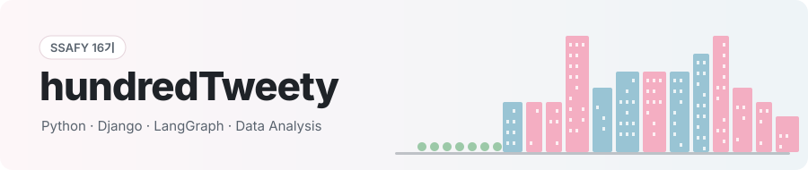
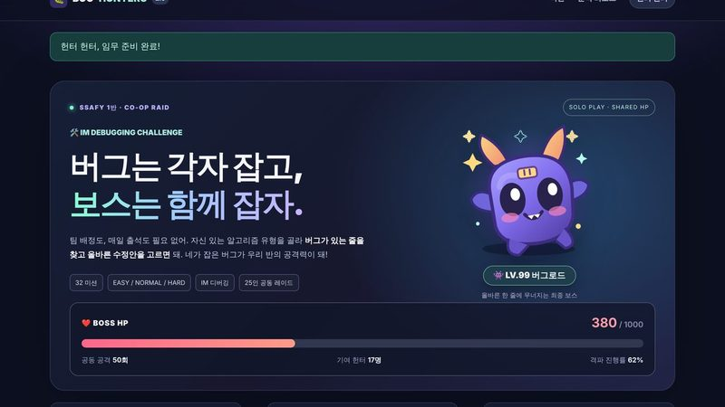
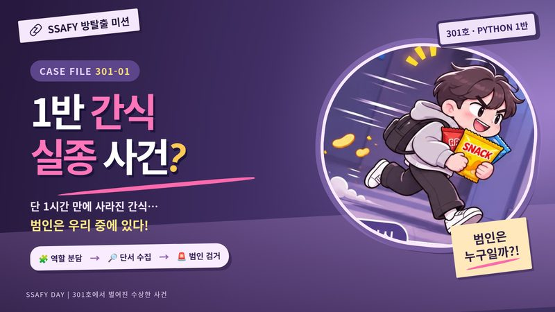
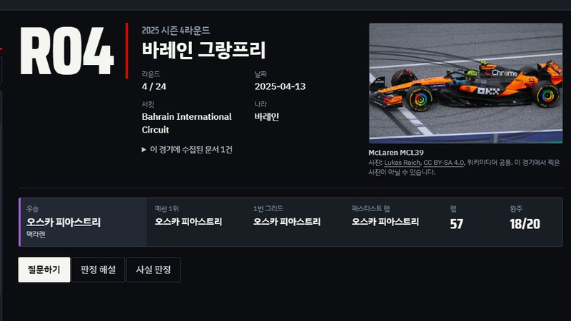
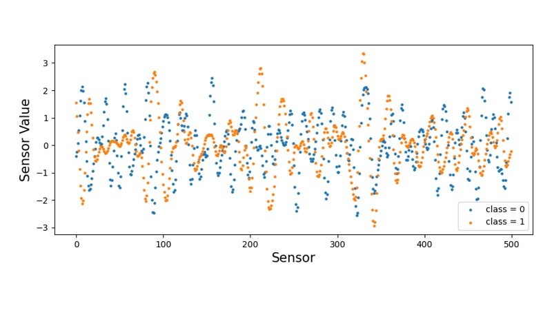
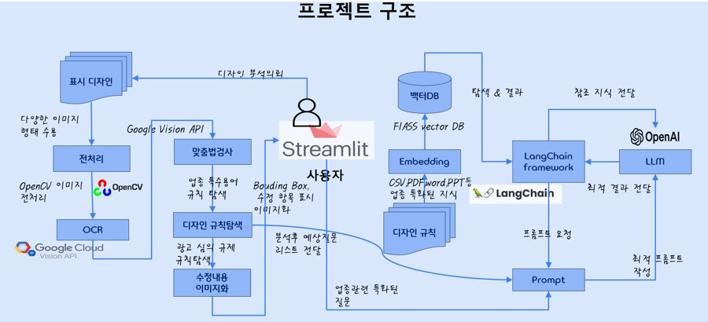

<picture>
  <source media="(prefers-color-scheme: dark)" srcset="./assets/hero_dark.svg">
  
</picture>

  

## 👋 About

- 🎓 **교육** — SSAFY(삼성 청년 SW·AI 아카데미) 16기 (2026.07 ~)
- 💼 **경력** — 반도체 계측장비 Application Engineer (2024.10 – 2026.01)
- 📜 **자격** — ADsP · 6시그마 Green Belt
- 📰 **활동** — SSAFYcial 기자 (SSAFY 16기)
- 🎯 **관심** — Python 백엔드, LLM·RAG 서비스, 제조 데이터 분석

## 🏆 Featured Projects

<table>
  <tr>
    <td width="50%" valign="top">
      
      <h3>🐛 <a href="https://github.com/hundredTweety/SSAFY-Bug-Hunters-2">BUG HUNTERS 2.0</a></h3>
      틀린 코드 한 줄을 고치면 반 전체가 공유하는 보스 HP가 깎이는 협동형 알고리즘 학습 서비스  
      📊 1인 개발 · 반 25명 중 <b>22명 참여</b> · 이틀 만에 보스 격파  
      
      
       
      🎮 <a href="https://ssafy-bug-hunters-2.onrender.com">데모</a> · 📊 <a href="https://ssafy-bug-hunters-2.onrender.com/results/">운영 리포트</a>
    </td>
    <td width="50%" valign="top">
      
      <h3>🍫 <a href="https://github.com/hundredTweety/ssafy-snack-escape">1반 간식 실종 사건</a></h3>
      4~5명이 서로 다른 화면의 단서를 주고받으며 범인을 찾는 팀 대항 협동 방탈출 웹 게임  
      📊 기획 · 운영 · <b>5팀 21명</b> 참여 · 모두 45분 안에 해결  
      
       
      🎮 <a href="https://hundredtweety.github.io/ssafy-snack-escape/">플레이</a> · 📊 <a href="https://hundredtweety.github.io/ssafy-snack-escape/report.html">결과 리포트</a>
    </td>
  </tr>
  <tr>
    <td width="50%" valign="top">
      
      <h3>🏎️ <a href="https://github.com/hundredTweety/f1_RAG">F1 레이스 노트</a></h3>
      경기 기록 · 위키백과 · FIA 규정을 근거로 답하고 근거 원문을 함께 보여 주는 RAG 서비스  
      📊 RAG 적용 후 근거 제시 <b>0 → 10/10</b> · 자동 테스트 53개  
      
      
       
      📄 <a href="https://github.com/hundredTweety/f1_RAG/tree/main/docs">설계 · 검증 문서</a>
    </td>
    <td width="50%" valign="top">
      
      <h3>🏭 <a href="https://github.com/hundredTweety/Ford">엔진 센서 이상 탐지</a> 2024</h3>
      Ford 엔진 센서 500개 시계열로 정상 / 이상 엔진을 분류한 제조 데이터 분석  
      📂 함께 보기: <a href="https://github.com/hundredTweety/Semiconductor">반도체 공정 분석</a> · <a href="https://github.com/hundredTweety/manufacturing-quality-eda">제조 품질 EDA</a> · <a href="https://github.com/hundredTweety/vehicle">YOLOv5 객체 탐지</a>  
      
      
       
      📓 <a href="https://github.com/hundredTweety/Ford">노트북</a>
    </td>
  </tr>
</table>

## 👥 Team Project

<table>
  <tr>
    <td width="42%" valign="top">
      
    </td>
    <td width="58%" valign="top">
      <h3>🔍 <a href="https://github.com/MoonSongAi/PjtCCC">ClearCutChecker</a> 2024 · 8인 팀</h3>
      건강기능식품 포장 디자인이 표시 규정에 맞는지 자동으로 검토하는 도구  
      <b>내 역할 — 표기 오류 검사</b>
      <ul>
        <li>「식품등의 표시기준」을 보고 검사 용어집 제작</li>
        <li>OCR이 놓치는 숫자·단위 띄어쓰기(예: <code>0.42mg</code>)를 영역 재인식으로 판별</li>
        <li>오류 위치를 이미지에 표시 → 최종 서비스 검사 모듈에 통합</li>
      </ul>
      
      
       
      🎬 <a href="https://youtu.be/6UcJPubfU5A">시연 영상</a> · 📂 <a href="https://github.com/MoonSongAi/PjtCCC/tree/master/Work/HrBaek">내 작업 폴더</a>
    </td>
  </tr>
</table>

🔒 그 밖에 — <b>PublicShield</b> 공공 웹사이트 숨은 불법 광고 탐지 · <b>주식 커뮤니티 분석</b> 수집 → 정제 → LLM 증강 (비공개 · 요청 시 공유)

## 🧰 Tech Stack

  
  
  
  
  
  
  
  
  

## 📰 최근 쓴 글 · SSAFYcial 기사, 매일 자동 갱신

<!-- BLOG:START -->
- 블로그 글을 불러오는 중이에요.
<!-- BLOG:END -->

## 🌆 Contribution City

최근 1년 커밋으로 그린 도시 · 매일 자동 갱신 · made with <a href="https://github.com/Dasmat13/git-world-action">GitWorld Engine</a>

